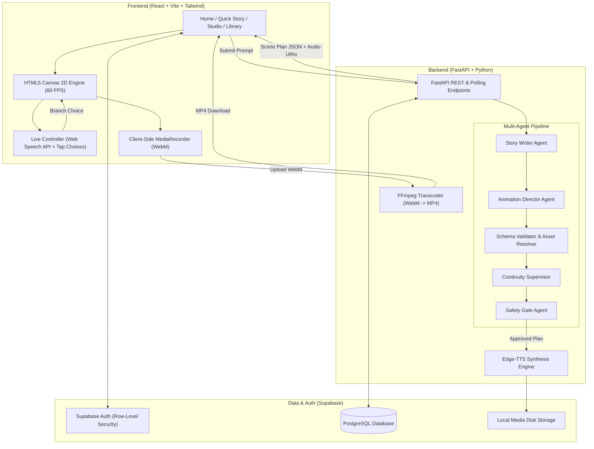

# VoxFable: Autonomous AI Cartoon Studio for Children

VoxFable is an autonomous AI cartoon studio for children built for Hackathon PS 16. It transforms a single story prompt into a fully voiced, musically scored, continuous animated episode in minutes. Featuring **The Cartoon That Listens**, children can speak directly into the microphone to guide story branches in real-time, while creators can use **Studio Mode** to batch-produce entire series with enforced character bibles and world continuity rules.

---

## Key Features

- **Quick Story (`/quick`)**: One-prompt cartoon generation with real-time generation stages (Story Writing, Scene Planning, Validation, Continuity, Safety, Voiceover). Instant 60 FPS Canvas 2D playback with synchronized lip-sync and camera moves.
- **The Cartoon That Listens (Live Mode)**: Interactive storytelling breaking the fourth wall. Characters pause at dramatic branch points and listen to the child's voice or on-screen choice taps, instantly splicing the next narrative beat.
- **Showrunner Studio (`/studio`)**: Define series bibles, customize character palettes/accessories with live canvas previews, enforce world consistency rules (e.g., "Pip never flies at night"), and batch generate entire seasons with automated Safety and Continuity verification scorecards.
- **Zero Character Drift**: Programmatic vector rendering guarantees characters maintain exact proportions, silhouettes, and color palettes across all scenes and episodes.
- **Client-Side MP4 Export**: High-performance browser recording via `canvas.captureStream()` transcoded via headless backend FFmpeg into universally playable MP4 videos.
- **Child-Safe by Default**: Dedicated multi-agent safety gate screens every scene plan against age appropriateness and scary content thresholds before audio synthesis.

---

## System Architecture



---

## Tech Stack

| Component | Technologies |
|---|---|
| **Frontend** | React 18, Vite, TypeScript, Tailwind CSS, Lucide React, Vitest |
| **Animation Engine** | Pure HTML5 Canvas 2D, Path2D vector primitives, Web Audio API |
| **Speech & Input** | Web Speech API (`webkitSpeechRecognition`), Acoustic amplitude lip-sync |
| **Backend** | Python 3.11+, FastAPI, Pydantic v2, Uvicorn, Pytest |
| **AI & Voice** | Google Gemini Flash / Groq LLM Adapter, Edge-TTS neural speech synthesis |
| **Media Processing** | FFmpeg (CLI) for WebM-to-MP4 video and AAC audio multiplexing |
| **Database & Auth** | Supabase (PostgreSQL with Row-Level Security, Supabase Auth) |

---

## Getting Started

### Prerequisites
- Node.js 18+ and `npm`
- Python 3.11+ and `pip`
- FFmpeg installed and available on system `PATH`
- (Optional) Supabase project for multi-user authentication

---

### 1. Backend Setup

```bash
# Navigate to backend and install Python dependencies
cd backend
pip install -r requirements.txt

# Configure backend environment variables
cp .env.example .env
# Edit .env with your LLM keys and Supabase credentials (see Environment Variables below)

# Run FastAPI development server with auto-reload (Port 8000)
uvicorn backend.app.main:app --reload --port 8000
```

Verify backend health:
```bash
curl http://localhost:8000/api/health
```

Run backend unit tests:
```bash
python -m pytest backend/tests
```

---

### 2. Frontend Setup

```bash
# Navigate to frontend and install dependencies
cd frontend
npm install

# Configure frontend environment variables
cp .env.example .env

# Start Vite development server (Port 5173)
npm run dev
```

Open `http://localhost:5173` in your browser.

Run frontend unit tests and typechecking:
```bash
npm --prefix frontend run typecheck
npm --prefix frontend test
```

---

### 3. Supabase Database & Migrations (Optional for Live Mode / Cloud Sync)

1. Create a project at [database.new](https://database.new).
2. Under **Authentication** > **Providers** > **Email**, toggle **Confirm email** to **OFF** for seamless hackathon testing.
3. In Supabase Dashboard, open **SQL Editor**, paste the contents of `supabase/migrations/0001_init.sql`, and click **Run**.
4. Verify tables (`profiles`, `series`, `characters`, `generations`, `episodes`) have Row-Level Security enabled.
5. Verify RLS isolation by running:
   ```bash
   python scripts/test_rls.py
   ```

---

## Environment Variables

### Frontend (`frontend/.env`)
```env
VITE_SUPABASE_URL=https://your-project.supabase.co
VITE_SUPABASE_PUBLISHABLE_KEY=your-anon-or-publishable-key
VITE_API_BASE=http://localhost:8000
```

### Backend (`backend/.env`)
```env
SUPABASE_URL=https://your-project.supabase.co
SUPABASE_SECRET_KEY=your-service-role-or-secret-key
DEMO_MODE=false
GEMINI_API_KEY=your-gemini-api-key
GROQ_API_KEY=your-groq-api-key
```

---

## Standalone Demo Mode & Safety Ladder

VoxFable includes a built-in multi-tier safety architecture for reliable presentations:

- **Level A (Full Live Pipeline)**: Real-time LLM story generation, dynamic TTS synthesis, and active Web Speech recognition.
- **Level B (Local Fallback)**: Automatically falls back to pre-computed narrative fixtures and cached audio if external API quotas or latency thresholds are exceeded.
- **Level C (Client-Side Standalone Demo Mode)**: Zero backend or network connectivity required. Click **"Demo Mode"** in the navigation bar to run bundled episodes (`Pip and the Glowing Door`) with pre-baked audio and instant MP4 downloads from `localStorage` and disk.

---

## Project Structure

```text
VoxFable/
├── assets/                  # Art metadata, audio scripts, and license registry
│   ├── metadata/            # JSON specifications for characters, backgrounds, props, sfx
│   ├── prepare_audio.ps1    # PowerShell audio conversion script
│   ├── prepare_audio.sh     # Bash audio conversion script
│   └── LICENSES.md          # Open-source and CC0 audio attributions
├── backend/                 # FastAPI backend application
│   ├── app/                 # Main app, pipeline agents, validators, routers
│   └── tests/               # Backend pytest suite
├── contracts/               # Shared JSON schemas and TypeScript contract interfaces
├── demo/                    # Pitch deck outlines, rehearsal scripts, and Judge Q&A
│   ├── DECK_OUTLINE.md      # 3-minute pitch deck outline and speaker notes
│   └── QA.md                # 14 concise judge Q&A defenses
├── docs/                    # Architecture, Master Context, preflight, status logs
│   ├── ART_STYLE.md         # Original 2D vector art style guide
│   ├── DEMO.md              # Rehearsed 3-minute demo script with stage cues
│   ├── Master_Context.md    # Single source of truth for VoxFable architecture
│   └── status/              # Agent synchronization status logs (om, maegan, nigel)
├── fixtures/                # Canonical episode plans and test fixtures
├── frontend/                # React 18 + Vite frontend application
│   ├── src/
│   │   ├── auth/            # Supabase authentication hooks and guards
│   │   ├── backgrounds/     # 5 multi-layer vector backgrounds (forest, meadow, treehouse, village)
│   │   ├── characters/      # 3 vector character rigs (owl, fox, kid) and drawing kit
│   │   ├── engine/          # Canvas 2D player, timeline clock, lip-sync, export recorder
│   │   ├── live/            # Web Speech API listener and intent matcher
│   │   ├── pages/           # Home, Quick Story, Studio, Library, Episode, and Auth pages
│   │   ├── props/           # 12 vector prop renderers
│   │   ├── studio/          # Character builder and series configuration forms
│   │   └── ui/              # Accessible design system components (Button, Card, Stepper, Badges)
│   └── public/demo/         # Bundled offline fallback episodes and audio
└── supabase/                # PostgreSQL schema and RLS security migrations
```

---

## Team & Roles

- **Om (Lead Developer & Demo Operator)**: Architecture, contracts, Supabase backend schema, FastAPI pipeline, LLM orchestration, validation & continuity agents, Edge-TTS integration, and stage operations.
- **Maegan (Engine Developer)**: HTML5 Canvas 2D engine, deterministic beat timeline resolver, audio synchronization, acoustic lip-sync viseme extraction, Live Mode speech recognition, and browser recording client.
- **Nigel (Art, UI & Pitch)**: 100% original vector character rigs (Owl, Fox, Kid), multi-layer backgrounds, 12 vector props, Tailwind UI design system, Quick Story & Studio interfaces, pitch deck, demo script, and documentation.

---

## Credits & Asset Licenses

All visual assets and code in VoxFable are original creations. All third-party sound effects and musical compositions are strictly licensed under Creative Commons Zero (CC0) or Creative Commons Attribution (CC-BY).

Detailed license records, source URLs, and author attributions are maintained in [assets/LICENSES.md](file:///c:/Users/ANSLEY/OneDrive/Desktop/VoxFable/DOOMnDEBUG/assets/LICENSES.md):
- **Background Music**: Curated from Free Music Archive and Incompetech (Kevin MacLeod) under CC0 / CC-BY 4.0.
- **Sound Effects**: Curated from Freesound.org under Creative Commons Zero 1.0 Public Domain.
- **Voiceover**: Microsoft Edge Read-Aloud Neural TTS (used for hackathon prototype testing).

---

## Known Limitations & Production Roadmap

- **TTS Licensing**: Edge-TTS is an unofficial wrapper around Microsoft Edge read-aloud services suitable for prototype demonstrations; commercial production will migrate to licensed Azure Speech SDK, ElevenLabs, or self-hosted Piper/Bark models.
- **Children's Speech Accents**: Browser Web Speech API accuracy varies with quiet speech or noisy room acoustics; tactile on-screen tap buttons are always provided as an immediate fallback.
- **Real-Time Video Transcoding**: Browser-side WebM capture followed by FFmpeg conversion takes roughly the duration of the episode; future work includes headless cloud worker rendering farms for instant background batch exports.
- **Future Enhancements**: Multi-language localization and dubbing, user sketch vectorization (drawing a character on paper and importing into the studio), and a creator character marketplace.
